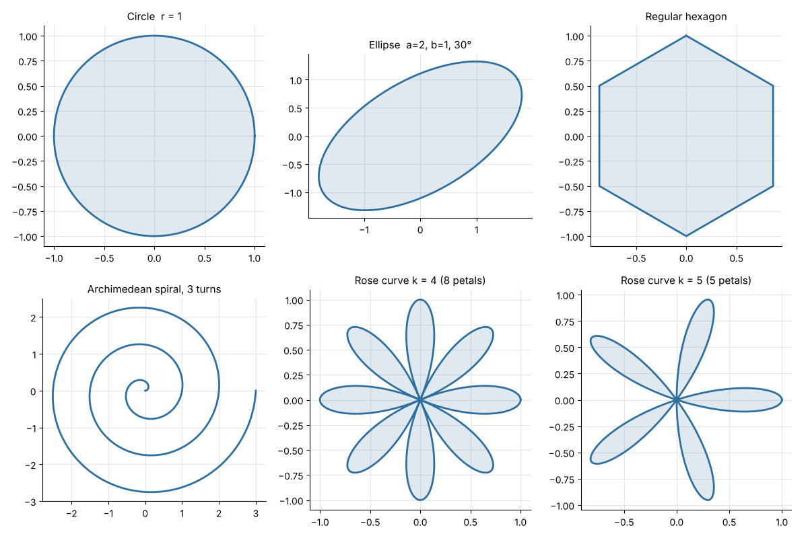

# create-circle-using-plotly

Draw circles — and a few of their relatives — with **Plotly**. The geometry lives in a small,
dependency-free NumPy module that returns plain coordinate arrays, so it can be tested and
reused anywhere; thin functions turn those arrays into interactive Plotly figures, and a
Matplotlib renderer produces static PNGs.



*Gallery rendered with the Matplotlib fallback (`python3 examples/gallery.py`).*

## Features

- `plotshapes.geometry` (NumPy only):
  - `circle(radius, center, n)` — closed outline, `n + 1` points (last point equals the first)
  - `ellipse(a, b, center, angle_deg, n)` — rotated ellipse
  - `regular_polygon(sides, radius, center, rotation_deg)` — inscribed regular polygon
  - `spiral(turns, spacing, n)` — Archimedean spiral, radius grows by `spacing` per turn
  - `rose(k, amplitude, n)` — rose curve r = a·cos(kθ): `k` petals if odd, `2k` if even
  - helpers: `rotate`, `is_closed`, `polygon_area` (shoelace), `path_length`
- `plotshapes.plotly_figures` — `circle_figure`, `circle_shape_figure` (Plotly's native
  `add_shape(type="circle")`), `ellipse_figure`, `polygon_figure`, `spiral_figure`,
  `rose_figure`, plus a generic `shape_figure(x, y)`. Axes use `scaleanchor` so circles stay
  round. Plotly is imported lazily inside these functions.
- `plotshapes.mpl_render.render_gallery()` — Matplotlib fallback that writes the PNGs in `docs/`.

## Install

```bash
git clone https://github.com/ariaesm/create-circle-using-plotly.git
cd create-circle-using-plotly
python3 -m pip install -r requirements.txt   # numpy, plotly, matplotlib (optional)
```

## Usage

### Interactive Plotly figures

```python
from plotshapes import plotly_figures as pf

fig = pf.circle_figure(radius=2.0)  # sampled points, filled Scatter trace
fig.show()

pf.circle_shape_figure(radius=2.0).show()  # Plotly layout shape
pf.rose_figure(k=5).write_html("rose.html")
```

`python3 examples/plotly_shapes.py` writes all figures to `out/*.html` (add `--show` to open
the circle in a browser).

### Geometry only

```python
>>> from plotshapes import geometry as g
>>> x, y = g.circle(2.0, n=8)
>>> len(x), g.is_closed(x, y), round(g.polygon_area(x, y), 4)
(9, True, 11.3137)
>>> x, y = g.circle(2.0, n=2000)
>>> round(g.polygon_area(x, y), 6), round(g.path_length(x, y), 6)   # π·r² = 12.566371
(12.56635, 12.566365)
>>> g.rose_petals(4)
8
```

### Static PNGs (no Plotly needed)

```text
$ python3 examples/gallery.py
wrote docs/circle.png
wrote docs/ellipse.png
wrote docs/hexagon.png
wrote docs/spiral.png
wrote docs/rose.png
wrote docs/rose5.png
wrote docs/gallery.png
```

## Tests

```bash
python3 -m pip install pytest
python3 -m pytest
```

The tests check geometry without Plotly: constant radius, closure and point counts,
area/perimeter convergence to π·r² and 2π·r, the ellipse equation under rotation, equal edge
lengths and exact areas of regular polygons, linear spiral growth, and petal counts of rose
curves. The Plotly layer is exercised with a stub `plotly` module; an additional test uses the
real library when it is installed (it is in CI). The Matplotlib gallery is rendered to a temp
folder and checked for valid PNGs. CI runs `ruff` and `pytest` on Python 3.12.

## License

[Apache License 2.0](LICENSE)
